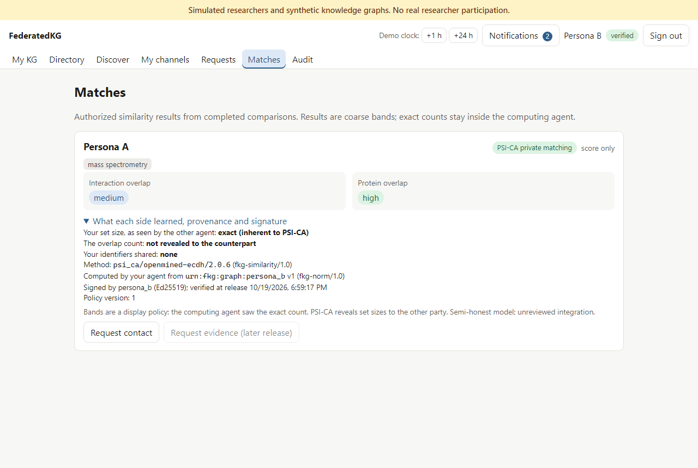

# FederatedKG

> **Simulated researchers and synthetic knowledge graphs. No real researcher participation.**
> Personas A–D cite published work by real scientists *only* as public research-theme inspiration. Those scientists
> are not users, participants or endorsers. Every account, graph, hypothesis, observation and permission is synthetic.

FederatedKG is a local web MVP. Researchers keep **private biology knowledge graphs on their own agents**, discover
each other through **published topics**, and compare graphs **only with manual approval**. The comparison uses
**PSI-CA** (private set intersection cardinality), so neither side sends its entity list. The central registry
coordinates identities, channels, requests, signed tickets and audit records, but it **cannot read any graph**.



## Quick start

Requirements: Docker (Engine or Desktop) with Compose v2, [uv](https://docs.astral.sh/uv/), and Node 22 (for the
browser tests).

```sh
git clone https://github.com/moghbaie/FederatedKG.git && cd FederatedKG
docker compose up -d --build --wait      # keys, registry, Postgres, 4 agents, web app
```

Open **http://localhost:8080**, click **Reset demo**, and sign in as any persona. Each browser tab keeps its own
session, so you can play all four researchers side by side. The fixtures are committed and the registry seeds the
public profiles at start-up, so there's no separate seeding step.

For a 2-minute narrated run of the whole workflow without clicking:

```sh
uv run python scripts/demo.py
```

## Commands

| Task | Command |
|---|---|
| Start, or rebuild after changes | `docker compose up -d --build --wait` |
| Stop, keeping data | `docker compose down` |
| Stop and wipe all data and keys | `docker compose down -v` |
| Reset the demo state (test mode) | **Reset demo** in the UI, or `uv run python scripts/reset_demo.py` |
| Regenerate fixtures after editing `scripts/fixture_spec.py` | `uv run python scripts/build_fixtures.py` (CI checks they're current) |
| Unit, in-process and static security tests (no stack needed) | `uv sync` then `uv run pytest` |
| Live stack tests (API, isolation, PSI-CA, leak scan) | `uv run pytest -m live` |
| Browser tests | `cd frontend && npm ci && npx playwright install chromium && npx playwright test` |
| Everything, plus `docs/test-report.md` | `uv run python scripts/run_e2e.py` |
| Refresh the documentation screenshots | `cd frontend && FKG_SCREENSHOTS=1 npx playwright test` |

## What it demonstrates

- **Journey A (one-to-many).**
  1. Persona A opens a 24-hour, topics-only channel for verified researchers.
  2. B, C and D discover it and request a comparison.
  3. A approves B, rejects C and leaves D pending. Only B receives a result.
  4. A pauses the channel and tightens the policy. A stale approval is invalidated, but B's earlier result stands.
  5. 24 hours later the channel expires and unfinished work lapses.
- **Journey B (one-to-one).** C sends D a targeted request. D approves, and both get their own signed result.
- **Owner control.** Pause, resume, close and versioned policy edits apply immediately. Result visibility is set
  separately from permission to compare. Nothing is ever sent automatically.
- **Privacy.**
  - Agent-to-agent PSI-CA, with exact counts kept inside the computing agent.
  - Only coarse bands are released, and results under 3 shared items are suppressed.
  - Tickets and tokens are Ed25519-signed, single-use and bound to the request.
  - Each agent applies its own local policy, independently of the registry.
  - A leak scan finds no private identifier anywhere outside its own agent.

## Documentation

| Document | Contents |
|---|---|
| [docs/architecture.md](docs/architecture.md) | Components, networks and storage isolation, comparison sequence, state machines, similarity, data |
| [docs/threat-model.md](docs/threat-model.md) | Assets, actors, trust boundaries, threats → mitigations → tests, residual risks, deployment checklist |
| [docs/api.md](docs/api.md) | Registry, test-mode and internal endpoints, and the scope contract |
| [docs/walkthrough.md](docs/walkthrough.md) | Screenshots of all eight screens through the full scenario |
| [docs/demo-script.md](docs/demo-script.md) | Presenter script for a live click-through, plus the narrated API demo |
| [docs/test-report.md](docs/test-report.md) | Latest generated test report (suites, counts, environment) |
| [plan.md](plan.md) | The consolidated MVP plan and v1 decisions |

## Repository layout

| Path | Contents |
|---|---|
| `frontend/` | React web app (eight screens), nginx proxy, Playwright tests (`frontend/tests/e2e`) |
| `registry/` | FastAPI registry, Alembic migrations |
| `agents/common/` | The single agent image. `agents/persona_*/` hold per-persona configuration and local policy only. |
| `fkg_protocol/` | Keys, service tokens, tickets, user tokens, result packages, `keygen` |
| `similarity/` | `public_topics` (Stage 1), `psi_ca` (OpenMined PSI 2.0.6), `scoped_baseline` (dev-only plaintext oracle) |
| `data/synthetic/` | `public/` profiles and sources (the registry's only fixture data); `private/` graphs (one per agent); `ground_truth.json` (tests only) |
| `scripts/` | Fixture builder, demo, reset, test runner |
| `tests/` | `unit`, `protocol`, `agents`, `registry` (in-process), `integration` and `security` (live) |

## Status

| Phase | Scope | State |
|---|---|---|
| 1 | Skeleton, isolated services, synthetic fixtures | done |
| 2 | Demo identities, verified membership, channels, 24-hour expiry, topic discovery | done |
| 3 | Requests, manual approvals, versioned policy, quotas, audit | done |
| 4 | Tickets, service authentication, agent-to-agent PSI-CA, guarded release, leak scan | done |
| 5 | Web UI with owner-only My KG | done |
| 6 | Automated four-researcher browser scenario | done |
| 7 | Documentation, threat model, demo script, test report | done |

## Known limitations

- **PSI-CA disclosure.** PSI-CA reveals set sizes, and it reveals the exact overlap to the output agent. Bands are a
  display policy, not a cryptographic guarantee. The model is semi-honest, and the integration hasn't had an
  external review.
- **Probing.** Chosen-input probing is slowed by quotas, minimum set sizes and low-count suppression, but not
  prevented.
- **Identity and transport.** The demo login has no real authentication. Internal traffic is HTTP authenticated by
  signed tokens. Deployment needs OIDC, mTLS and managed keys.
- **Test mode is on locally** (adjustable clock, reset, payload capture, injected delay). Advancing the clock 24
  hours signs out other open tabs, because their sessions expire on the same clock.
- **Topic scoping.** Scope topics gate a comparison but don't filter entities, because fixture entities aren't tagged
  with individual topics.
- **Not in v1:** evidence sharing, contradiction comparison across researchers, real onboarding, PSI variants beyond
  PSI-CA, and multi-worker registry deployment.

See [docs/threat-model.md](docs/threat-model.md) for the full list and the deployment checklist.

## Data provenance

- Protein identifiers are UniProtKB accessions, all verified as reviewed entries (UniProt, CC BY 4.0).
- Detection methods are PSI-MI terms, verified through EBI OLS4.
- Citations were verified through Crossref. See `data/synthetic/public/sources.csv` and [NOTICE](NOTICE).

## License

Apache License 2.0. See [LICENSE](LICENSE) and [NOTICE](NOTICE).
