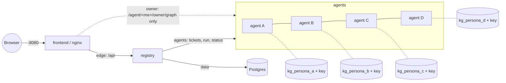
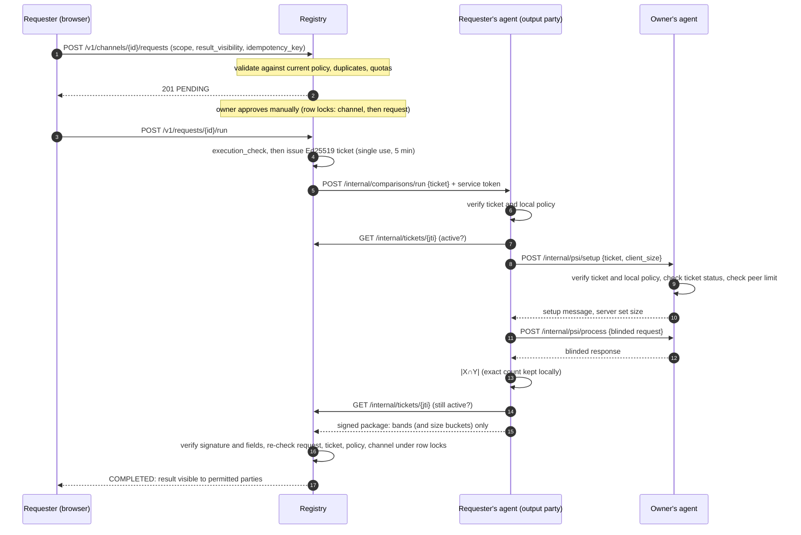
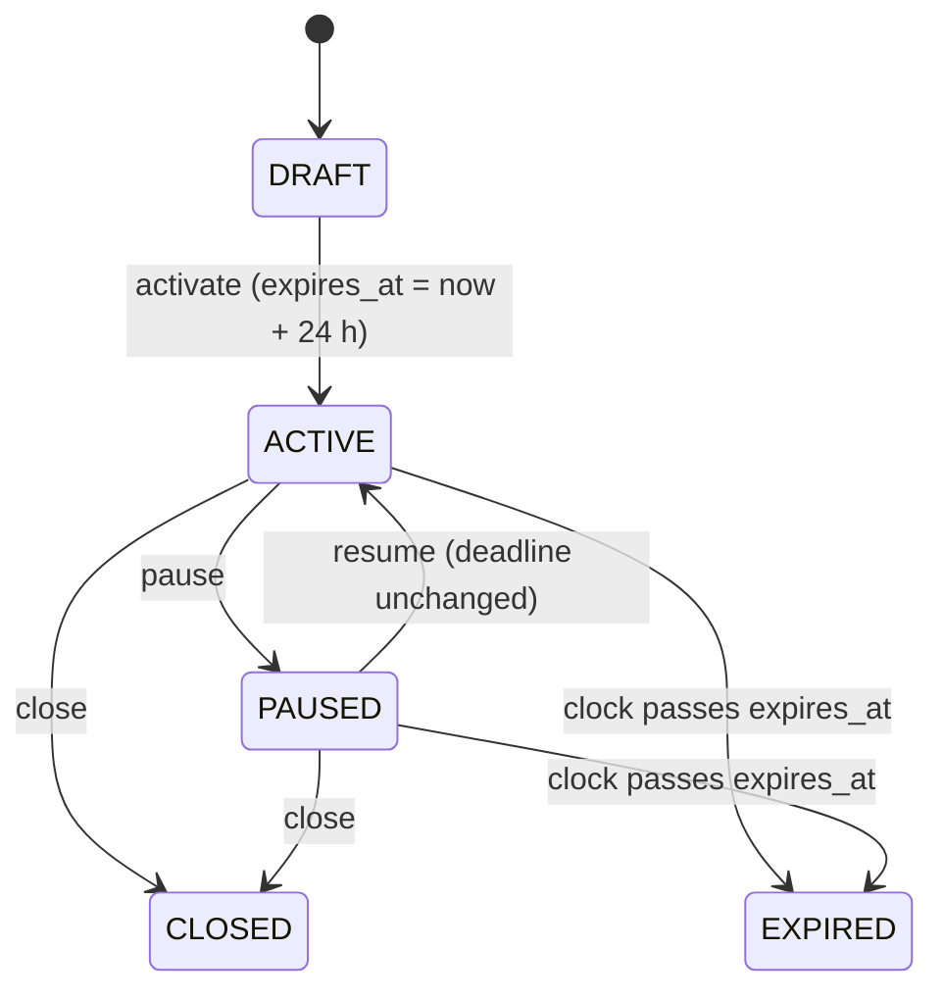
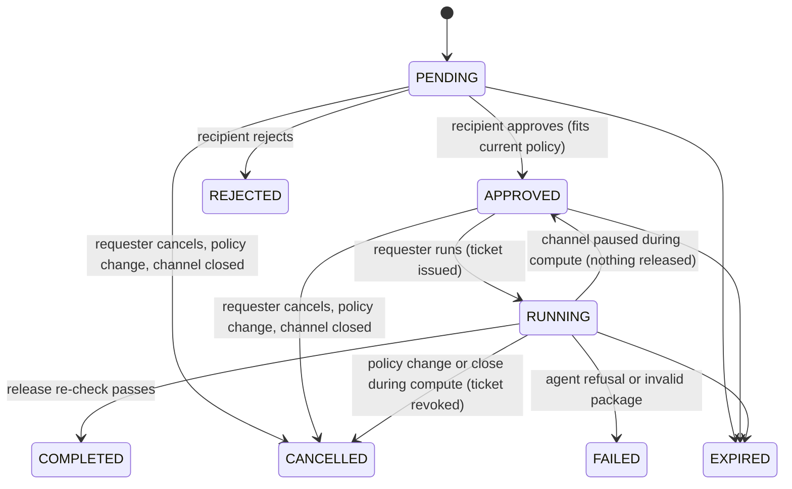

# Architecture

FederatedKG lets researchers discover each other through **published topics**, then, with **manual approval**,
compare their private knowledge graphs using **PSI-CA** (private set intersection cardinality). The central
registry coordinates identities, channels, requests, tickets and audit records. It **never** has access to a
private graph.

## Components

| Component | Code | Role | Holds |
|---|---|---|---|
| Web app | `frontend/` (React, TanStack Query, Cytoscape, nginx) | The eight screens; proxies `/api` to the registry and each owner's `/agent/<persona>/owner/graph` to that owner's agent | Nothing persistent (a session token per browser tab) |
| Registry | `registry/` (FastAPI, SQLAlchemy, Alembic) | Identity, channels, requests, policy versions, tickets, release gating, notifications, audit | Postgres: public profiles, channels, requests, tickets, released result packages, audit metadata |
| Postgres | `postgres:16-alpine` | Registry database | Registry data only |
| Agents A–D | `agents/common/` (one image) + `agents/persona_*/` (configuration only) | Hold one private RDF graph each; enforce local policy; run PSI-CA with peers; serve the owner's own graph view | Private graph, exact-count log, single-use ticket record, per-counterpart counters |
| Protocol | `fkg_protocol/` | Shared signing and verification: keys, service tokens, tickets, user tokens, result packages | — |
| Similarity | `similarity/` | `public_topics` (Stage 1), `psi_ca` (OpenMined PSI 2.0.6), `scoped_baseline` (plaintext oracle, dev only) | — |
| keygen | `fkg_protocol/keygen.py` | One-shot: an Ed25519 key per service, written only into that service's volume | — |

## Network and storage isolation

| Network | Members | Internal | Carries |
|---|---|---|---|
| `edge` | frontend, registry | no (only the frontend publishes a host port) | Browser API traffic |
| `data` | registry, postgres | yes | SQL |
| `agents` | registry, agents | yes | Ticket dispatch, ticket-status checks, health, test-mode clock and reset |
| `peer` | agents only | yes | PSI-CA protocol messages (blinded elliptic-curve points) |
| `owner` | frontend, agents | yes | The owner-only `My KG` view (nginx proxies exactly one path per agent) |

Who can read what:

| Data | Lives in | Readable by |
|---|---|---|
| Private graph (`data/synthetic/private/<persona>.ttl`) | A read-only bind mount and the `kg_<persona>` volume | Only that persona's agent. Excluded from every image build context. |
| Exact intersection counts | The agent's `comparisons.jsonl` | Only the computing (output) agent |
| Released result packages | Registry Postgres | The parties permitted by `result_visibility` |
| Ed25519 private keys | `keys_<service>` volume | Only that service. The `keygen` container runs once, with no network. |
| Ground truth (`data/synthetic/ground_truth.json`) | The repository only | Tests. Never mounted or built into an image. |

`tests/security/test_isolation.py` enforces these rules for both the compose configuration and the running
containers, using canary identifiers planted in each graph.

## Comparison flow

When `result_visibility` is `both`, the registry dispatches to both agents. Each one is the output party once,
so each side computes its own result.

## State machines

Expiry is derived from `expires_at` against the registry clock on **every** read and action. A stored status
flag is never trusted on its own. Every transition records an audit event. Terminal transitions revoke any
outstanding ticket.

## Similarity

- **Stage 1 (`topic_similarity`)** is Jaccard over the published topic identifiers only. It is shown in the
  Directory and Discover screens.
- **Stage 2** is PSI-CA over normalized identifiers (`fkg-norm/1.0`):
  - **Protein:** UniProt accessions.
  - **Interaction:** sorted accession pairs.
  - The output agent derives Jaccard (or the raw count) from the exact intersection and both set sizes, and
    releases only a band: `insufficient_disclosure` below 3 shared items, otherwise `low` (Jaccard < 0.2),
    `medium` (< 0.4) or `high`.
  - The `summary` disclosure level adds set-size ranges.
- **Contradictions** are detected locally only (shown in My KG): `supporting`, `contradictory_candidate`,
  `context_mismatch` and `insufficient_information`.

Scope topics act as a **gate**: both the registry policy and each agent's local policy must allow them. They don't
filter entities, because the fixture entities aren't tagged with individual topics.

## Data

The `scripts/build_fixtures.py` script generates the fixtures deterministically from `scripts/fixture_spec.py`.
A test verifies that regenerating them reproduces the committed files byte for byte.

| Persona | Entities | Relationships | Hypotheses | Observations |
|---|---:|---:|---:|---:|
| A | 26 | 42 | 3 | 8 |
| B | 26 | 40 | 3 | 6 |
| C | 28 | 41 | 3 | 6 |
| D | 29 | 44 | 3 | 7 |

Each graph includes:
- one canary entity, used by the leak tests;
- one private topic that is never published;
- at least one fabricated contradiction.

Protein overlaps range from 12 shared (A–B) down to 1 (A–D), so the low-count suppression rule gets exercised.
