# Screenshot walkthrough

These screenshots come from a real run against the local stack. To regenerate them, run
`cd frontend && FKG_SCREENSHOTS=1 npx playwright test`. All accounts and data are simulated.

## 1. Sign in

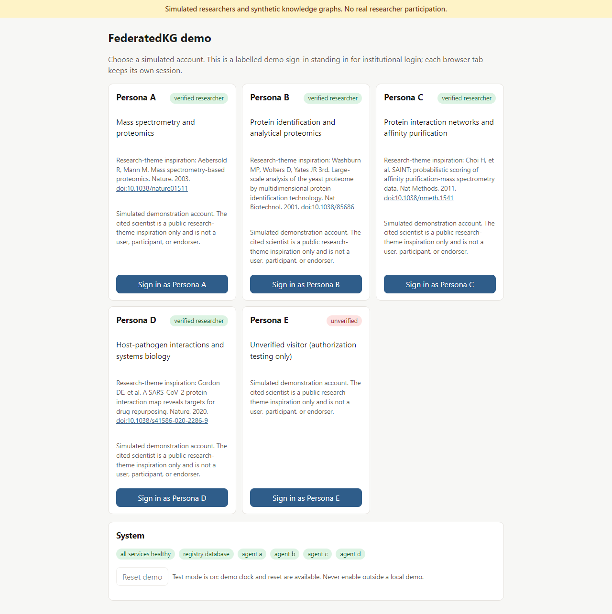

The sign-in page offers five labelled demo accounts. Each card cites published work by a real scientist as research-theme
inspiration only. Persona E is the unverified account. The **System** panel shows health, and in test mode it also
has **Reset demo**.

## 2. My KG (owner only)

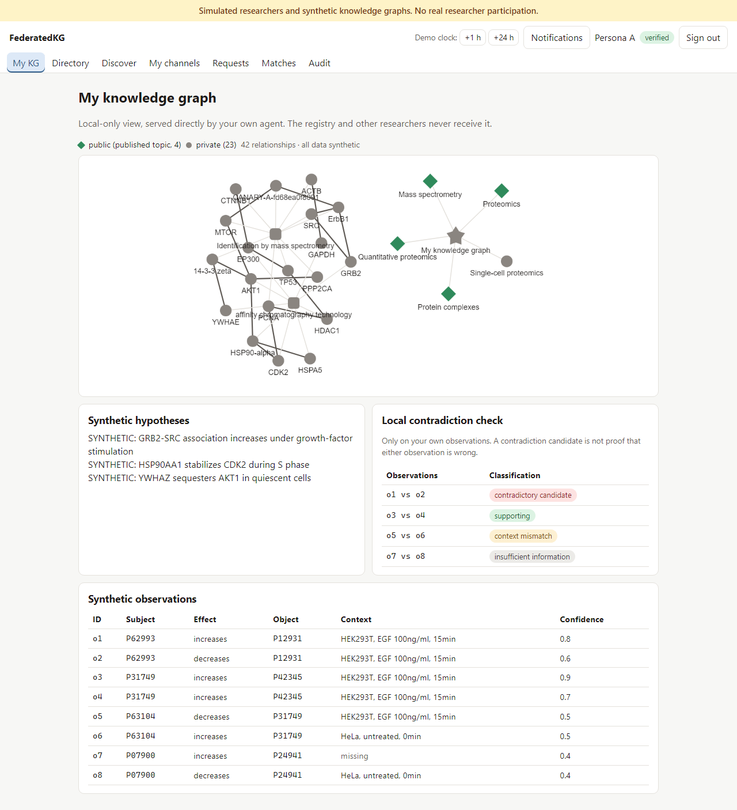

Persona A's own graph, served directly by A's agent:
- published topics are green diamonds; everything else is private;
- below the graph: the synthetic hypotheses, the observations, and the local contradiction check.

## 3. Directory

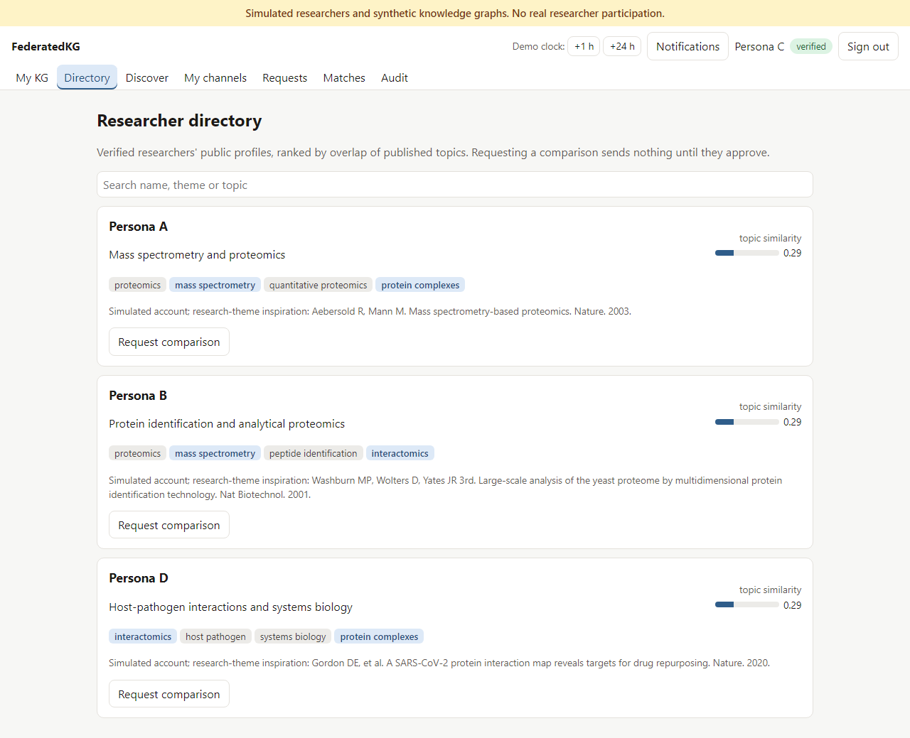

Verified researchers, ranked by overlap of published topics. Shared topics are highlighted. **Request comparison**
opens a one-to-one request form.

## 4. My channels: open a 24-hour channel

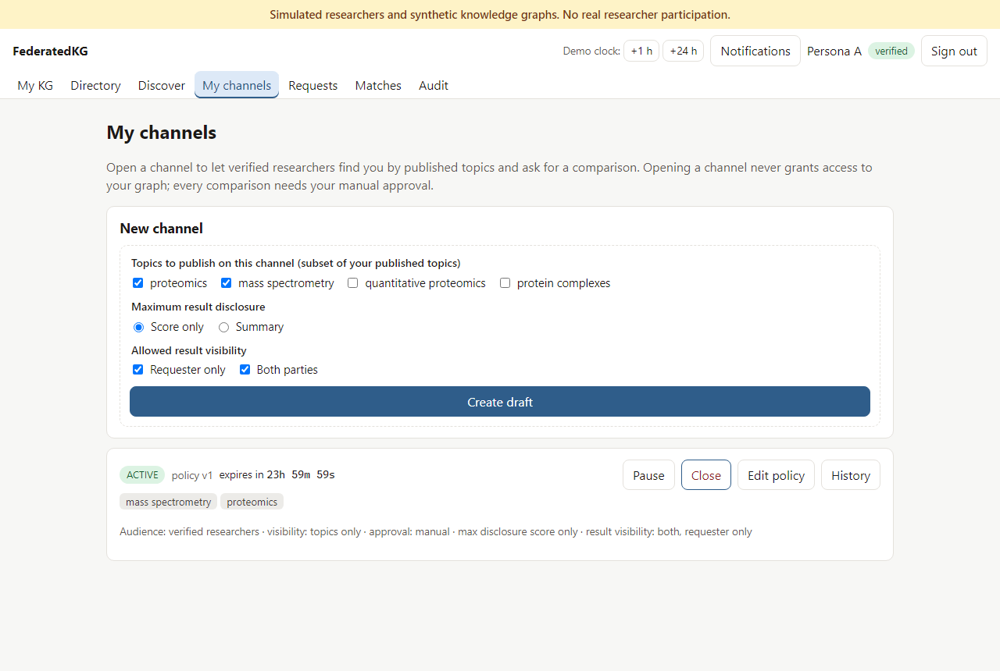

A creates a draft with an opt-in subset of published topics, a maximum disclosure level and the allowed result
visibility, then activates it. The countdown runs on the registry clock.

## 5. Discover and request

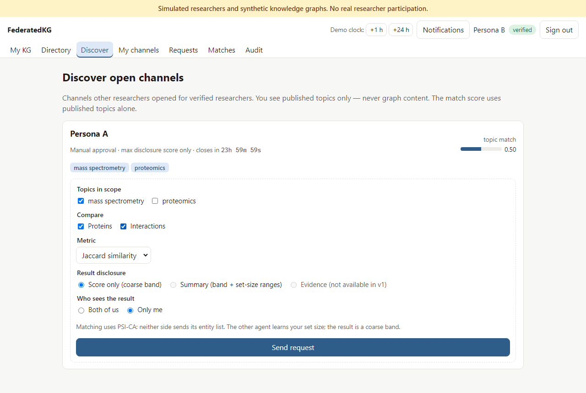

B sees only A's channel topics and a topic-match score. The request form offers only what A's policy allows.
Evidence sharing isn't available in v1.

## 6. Requests: inbox

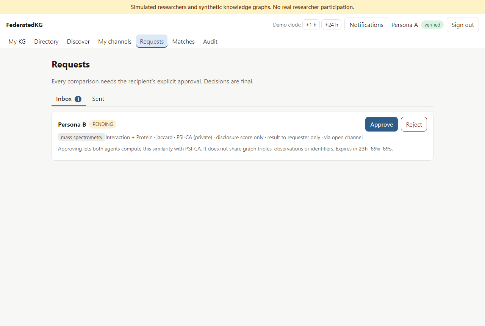

A reviews the exact scope: topics, classes, metric, protocol, disclosure level and who sees the result. A then approves
or rejects it. Approving a comparison never shares triples, observations or identifiers.

## 7. Requests: sent

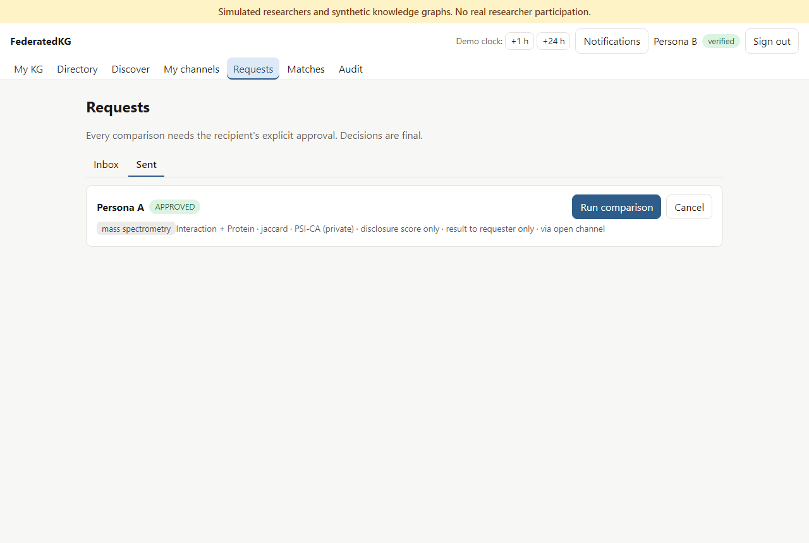

B runs the approved comparison. If the channel is paused or the policy has changed, the button is disabled and the
reason is shown.

## 8. Matches

B's result is a coarse band, with:
- the PSI-CA badge;
- what each side learned;
- provenance and an Ed25519 signature by B's own agent;
- a manual, in-app contact request.

Evidence sharing is shown as a later feature.

## 9. Pause and tighten the policy

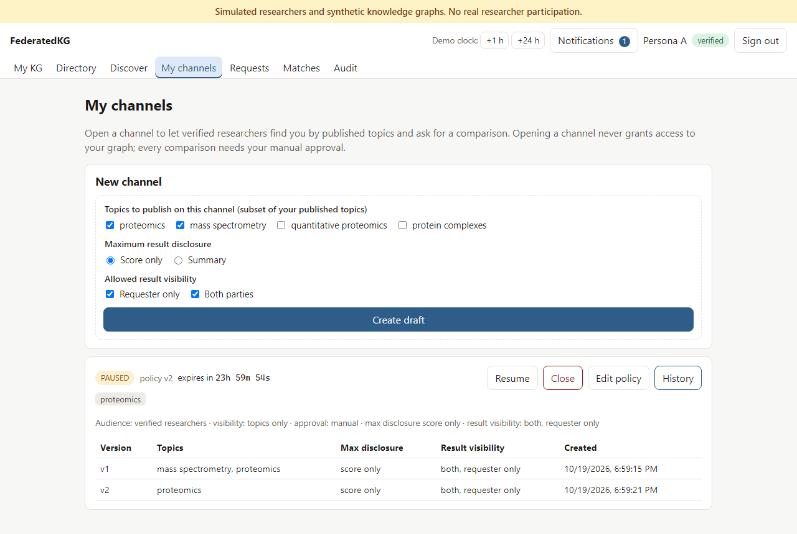

A pauses the channel and removes a topic, which creates policy version 2. Open requests that no longer fit are
cancelled immediately, and the version history is kept.

## 10. Expiry

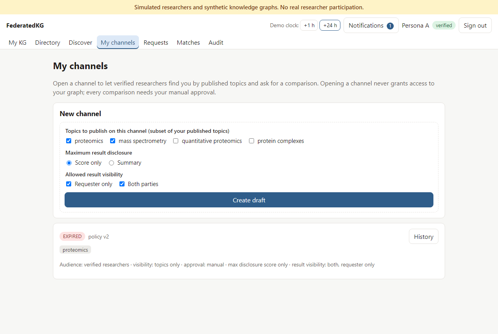

After the demo clock advances 24 hours, the channel is expired and its controls are gone. Unfinished work expires
with it. Earlier results stay visible to whoever was entitled to them.

## 11. Audit

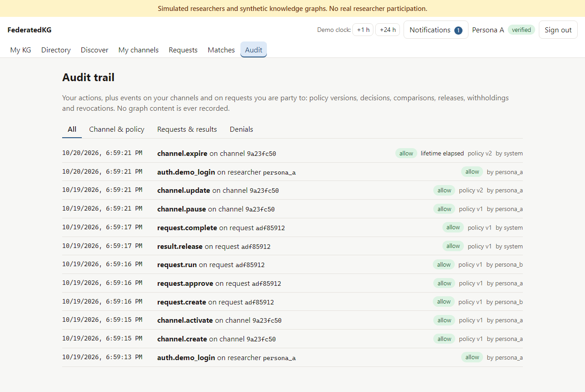

A's timeline covers channel and policy changes, decisions, runs, releases, invalidations and expiries. Filters
narrow it to policy, requests and results, or denials.

## 12. Unverified Persona E

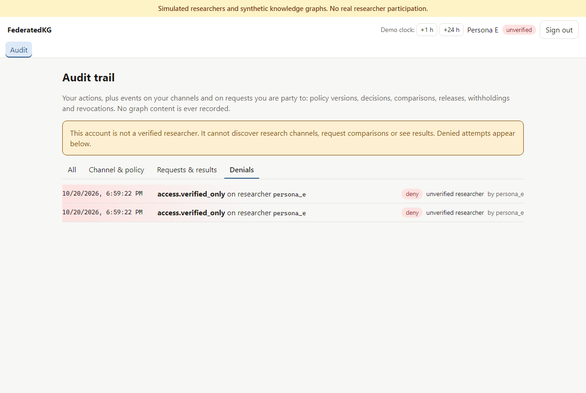

E can only see its own audit trail. Its attempts to use research endpoints were refused and recorded.

## 13. Phone width

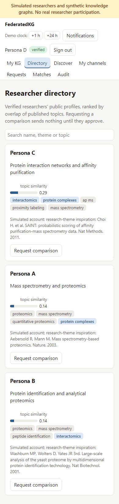

The layout adapts to a 390 px-wide screen.
